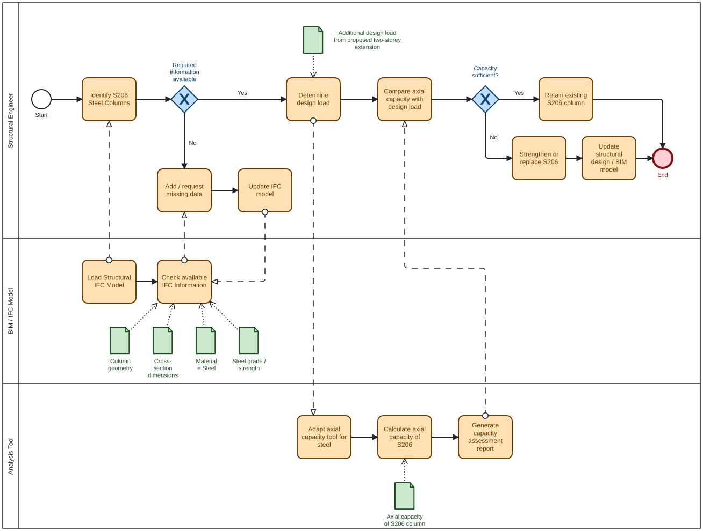
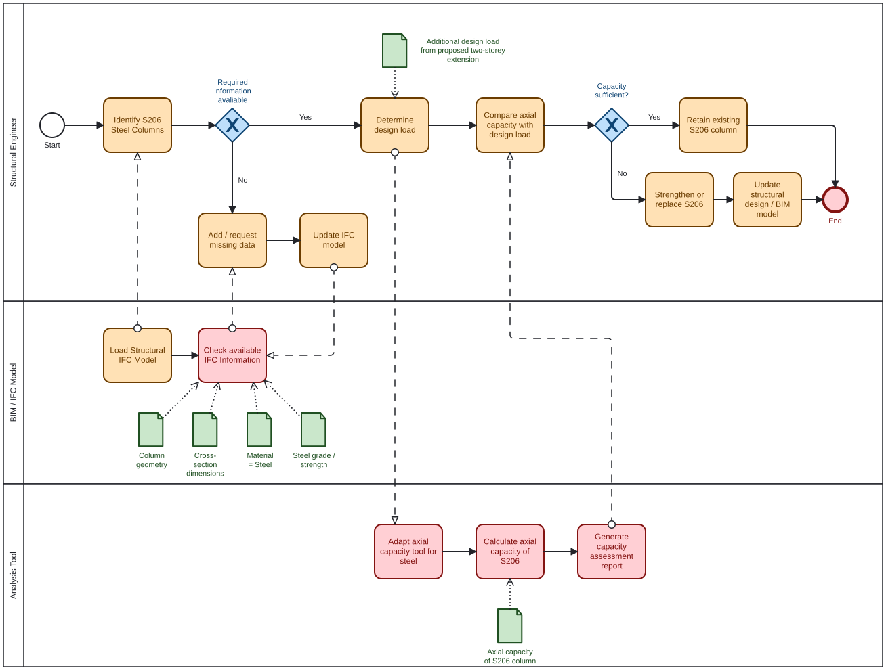
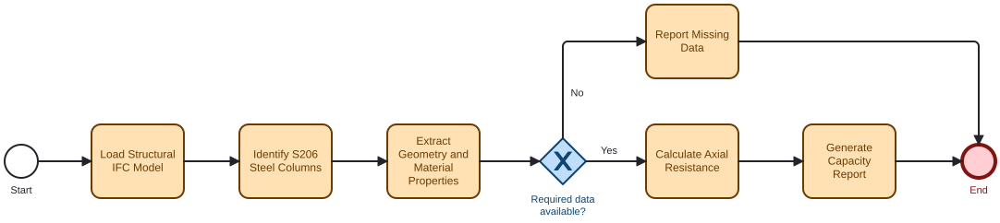

# Assignment 2 – Use Case

**Group:** 23  
**Focus Area:** Structures  
**Building:** #2606  
**Report:** 26-06-A-ClientReport-Anon

## A2a: About Our Group

**Python coding confidence**

Our group's combined Python confidence score is **[insert total score]**.

**Focus area and role**

Our group's focus area is structures, specifically columns. We are looking at a specific steel column, S206, which was identified in the previous report as potentially not having sufficient capacity for the proposed two-storey extension. We are analysts.

## A2b: Identify Claim

**Building**

For our focus area, we will be using Building #2606. The issue was identified in a report from Group 6 in Advanced Building Design 2026.

**Claim**

Check if the existing S206 steel columns have sufficient axial load-bearing capacity to support the additional loads from the proposed two-storey extension.

**Description**

The Client Report (p. 10) states that the existing S206 steel columns may not have sufficient capacity for the additional loads caused by the proposed two-storey extension.

The report identifies the S206 columns as 60 × 60 mm solid square steel columns and states that they will likely need to be replaced for the proposed construction.

The aim of this investigation is therefore to identify the S206 columns in the IFC model, extract their geometry and material properties, and assess their axial load-bearing capacity.

**Justification**

By focusing on the S206 steel columns, we can use the BIM model to investigate their geometry and material properties and assess whether they have sufficient axial capacity for the additional loads from the proposed extension.

## A2c: Use Case

### How would you check this claim?

1. Identify the S206 steel columns in the structural IFC model.
   - Extract the column dimensions and geometry.
   - Extract the available material properties.
   - Check whether the required information for a steel capacity calculation is available.
2. Determine the design load acting on the S206 columns from the proposed two-storey extension.
3. Calculate the axial load-bearing capacity of the columns using the extracted IFC data and relevant steel design parameters.
4. Compare the design load \(N_{Ed}\) with the column resistance \(N_{Rd}\).
5. Determine whether the existing columns have sufficient capacity or whether strengthening/replacement is required.
6. Generate a report showing the extracted data, calculations and results.

### When would this claim need to be checked?

The claim should be checked during the design phase, before the proposed two-storey extension is approved and detailed. The capacity of the existing columns needs to be verified before additional loads are introduced to the structure.

### What information does this claim rely on?

The assessment relies on information about the S206 columns, including their location, geometry, cross-section dimensions, material, steel strength and column length. In addition, the design load from the proposed two-storey extension is required in order to compare the applied load with the structural resistance of the columns.

### What phase does the use case belong to?

Design phase. The structural capacity should be verified before the extension is constructed and before the final structural design is approved.

### What BIM purpose is required?

The main BIM purpose is **Analyse**, because BIM information is used to assess the structural capacity of the existing S206 columns.

**Gather** is also relevant, since geometry and material information first needs to be extracted from the IFC model.

### What BIM use case is this closest to?

The use case is closest to structural analysis, specifically the example "IFC Column axial capacity analysis".

This use case extracts information about columns from an IFC model and uses it to calculate their axial capacity. Our use case extends this idea by focusing specifically on the existing S206 steel columns and comparing their capacity with the additional design load from the proposed extension.

### BPMN Diagram – Overall Workflow

The BPMN diagram below illustrates the proposed workflow for investigating the structural capacity of the S206 steel columns.

## A2d: Scope the Use Case

The new tool will focus on the part of the use case where information about the S206 columns is extracted from the IFC model and used to calculate their axial capacity.

The tool should:

- Identify the relevant S206 columns.
- Extract their geometry and material information.
- Determine the cross-sectional area.
- Obtain or accept the required steel strength.
- Calculate the axial resistance of the column.
- Present the result for comparison with the design load.

Determining the complete loading from the proposed extension and redesigning or replacing the column are outside the main scope of the tool.

### BPMN Diagram – Tool Scope

The highlighted activities in the diagram below represent the scope of the proposed Python tool.

## A2e: Tool Idea

### Proposed OpenBIM Tool

Our tool will be a Python-based OpenBIM tool using IfcOpenShell. The tool will identify the S206 steel columns in the structural IFC model and extract relevant information such as geometry, cross-section dimensions, column length and material properties.

The extracted information will then be used to calculate the axial load-bearing capacity of the column. The result can be compared with the design load from the proposed two-storey extension to support the assessment of whether the existing column can be retained, strengthened or replaced.

### Business and Societal Value

The tool can reduce the amount of manual work required when assessing existing structural elements and make better use of information already available in BIM models. Automated extraction also reduces the risk of transcription errors and makes structural assessments more transparent and repeatable.

From a societal perspective, the tool can support the reuse of existing structures by helping engineers determine whether existing elements can safely remain in use instead of being unnecessarily replaced. This can reduce material consumption, construction waste and embodied carbon.

### BPMN Diagram – Tool Idea

The following diagram summarises the proposed Python tool and its main functions.

## A2f: Information Requirements

*To be completed.*

## A2g: Software Licence

*To be completed.*
