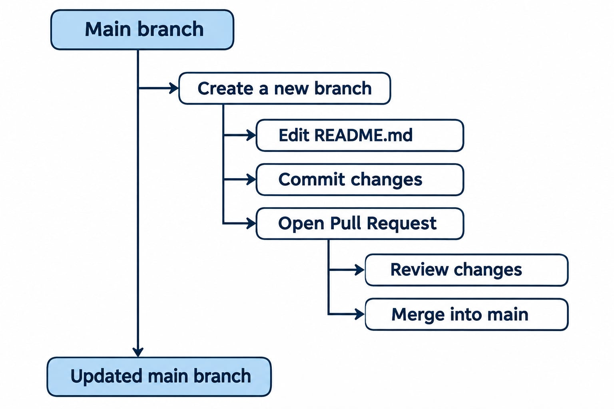

# Assignment 3 – Teach

# GitHub Branches and Pull Requests for BIM Collaboration

**Course:** 41934 Advanced BIM  
**Group:** 23 – Structures  
**Topic:** GitHub collaboration and version control  
**Target audience:** BIM students with basic GitHub experience  

---

## Tutorial Summary

This tutorial introduces GitHub as a collaboration platform for BIM projects, focusing on branches and pull requests. Through a practical example, students will learn how to work independently, review changes, and combine contributions in a shared repository.

## 1. Introduction

GitHub is a platform for version control and collaboration. It allows users to store project files, track changes, and work together in a shared repository.

In BIM projects, multiple team members may work on reports, scripts, diagrams, and model-related documentation. GitHub helps teams organize these contributions and keep track of different versions.

This tutorial focuses on two useful GitHub features: Branches and Pull Requests.

## 2. Learning Objectives

After completing this tutorial, students should be able to:

- Explain the purpose of branches and pull requests.
- Create a new branch in a GitHub repository.
- Make and commit changes without directly editing the main branch.
- Create and review a pull request.
- Merge changes into the main branch.
- Apply this workflow when collaborating on BIM projects.

## 3. Understanding Branches and Pull Requests

### What is a Branch?

A branch is a separate line of development within a repository. It allows users to work on changes without directly modifying the main version of the project.

For example, a student working on structural documentation can create a branch called `update-structural-report` while other team members continue working on their own tasks.

### What is a Pull Request?

A pull request (PR) is a request to review and merge changes from one branch into another.

Pull requests allow teammates to:

- Review proposed changes.
- Discuss improvements.
- Identify possible conflicts.
- Approve changes before merging them into `main`.

### Example Workflow

  

  <em>Figure 1. GitHub Branches and Pull Requests Workflow.</em>

*Figure 1. Workflow showing how branches and pull requests are used to update the main branch.*

## 4. Step-by-Step Tutorial

For this demonstration, we will use a sample BIM project repository containing a README file.

### Step 1 – Create a New Branch

1. Open your GitHub repository.
2. Click the branch selector, usually displaying `main`.
3. Enter a new branch name, for example `update-structural-report`.
4. Select the option to create the new branch from `main`.
5. Make sure you are now working on your new branch.

### Step 2 – Make Changes and Commit

1. Open `README.md` while on your new branch.
2. Click the edit (pencil) icon.
3. Add a short section about your BIM project.
4. Click **Commit changes**.
5. Enter a descriptive commit message, such as `Add structural analysis section`.
6. Commit the changes to your feature branch.

### Step 3 – Create a Pull Request

1. Open the **Pull requests** tab.
2. Click **New pull request**.
3. Select `main` as the base branch.
4. Select `update-structural-report` as the compare branch.
5. Review the proposed changes.
6. Click **Create pull request**.
7. Add a short description explaining what was changed.

### Step 4 – Review and Merge

1. Ask a teammate to open the pull request.
2. Review the changes under **Files changed**.
3. Discuss any necessary improvements.
4. If the changes are ready and merging is permitted, click **Merge pull request**.
5. Confirm the merge.
6. Return to `main` and verify that the changes are included.

## 5. Common Mistakes and How to Avoid Them

| Common mistake | Recommended solution |
|---|---|
| Editing directly on `main` | Create a feature branch before making changes. |
| Pull request contains unexpected changes | Check the base and compare branches. |
| Changes are missing from GitHub | Make sure the changes were committed and pushed. |
| Merge conflict occurs | Review and resolve conflicting changes before merging. |
| Unclear commit messages | Use short, descriptive commit messages. |

> **Important for BIM projects:** GitHub is particularly useful for text-based files such as Markdown, Python scripts, and documentation. IFC model files can be versioned, but changes to the same IFC file may not be easy to compare or merge using standard Git tools.

## 6. Practical Exercise – Try It Yourself!

Now it is your turn to practice using branches and pull requests.

## 7. Video Tutorial

Watch our step-by-step demonstration of the workflow described above.

**Video:** [Watch the tutorial](INSERT_VIDEO_LINK_HERE)

## 8. Conclusion

Branches and pull requests help BIM project teams collaborate in an organized and transparent way. By working on separate branches, team members can develop changes independently, review each other's contributions, and merge approved updates into the main project.

This workflow is especially useful for BIM documentation, scripts, and other text-based project files.

## 9. References

- [GitHub Docs – About branches](https://docs.github.com/en/pull-requests/collaborating-with-pull-requests/using-branches/about-branches)
- [GitHub Docs – About pull requests](https://docs.github.com/en/pull-requests/collaborating-with-pull-requests/proposing-changes-to-your-work-with-pull-requests/about-pull-requests)
- [GitHub Docs – Creating a pull request](https://docs.github.com/en/pull-requests/collaborating-with-pull-requests/proposing-changes-to-your-work-with-pull-requests/creating-a-pull-request)

---

*Prepared by Group 23 – Structures | DTU Advanced BIM*
  
